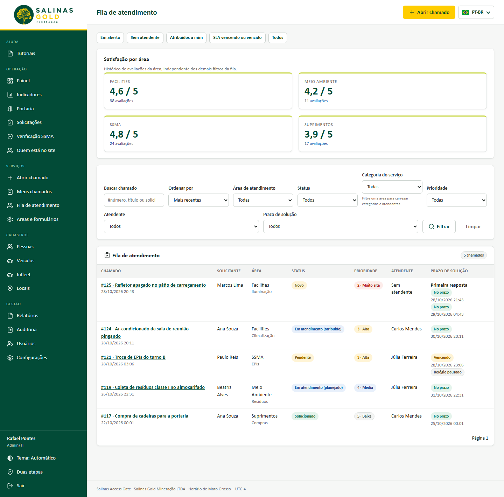
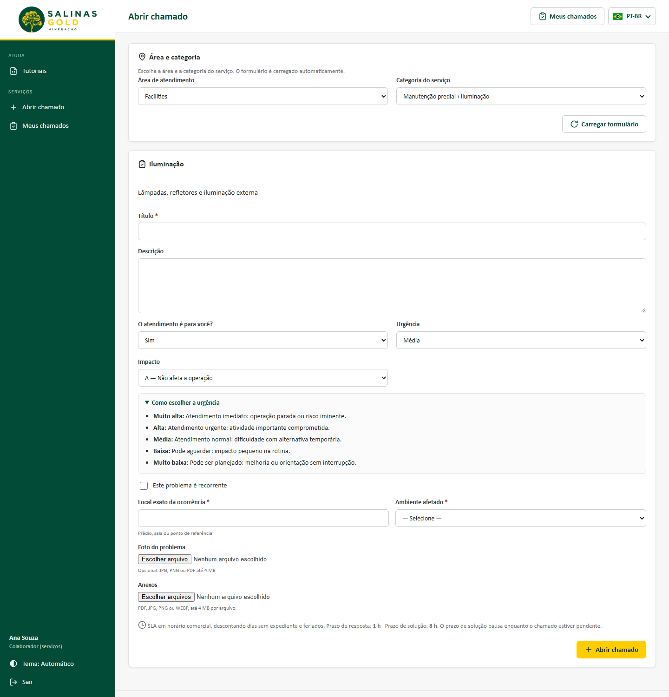
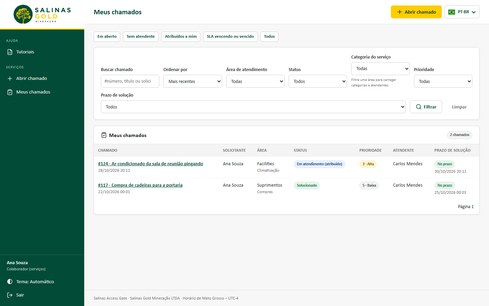
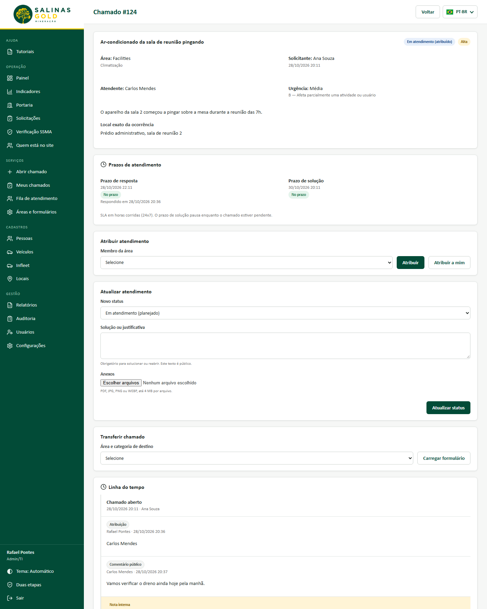
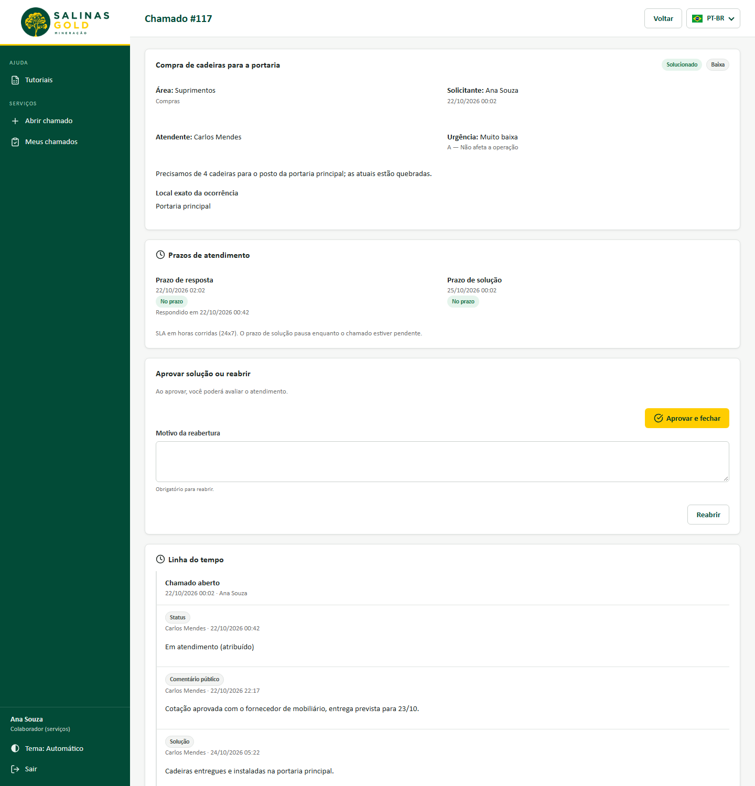
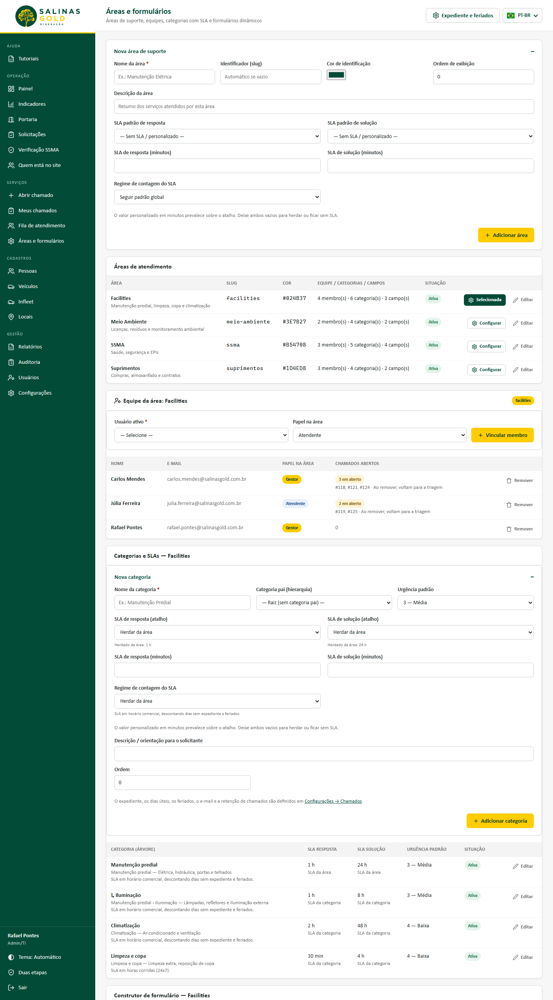
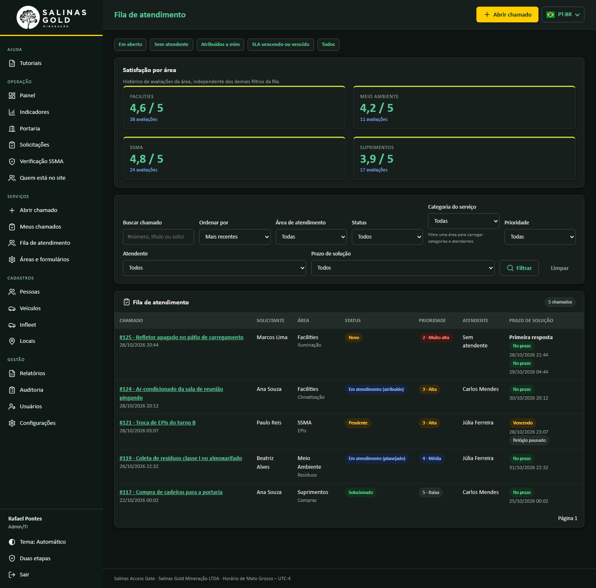
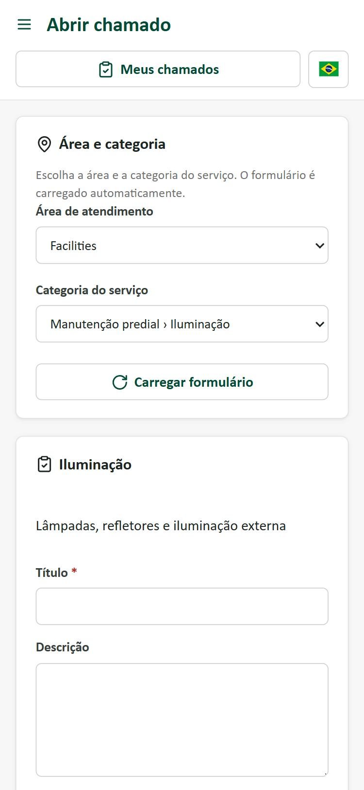
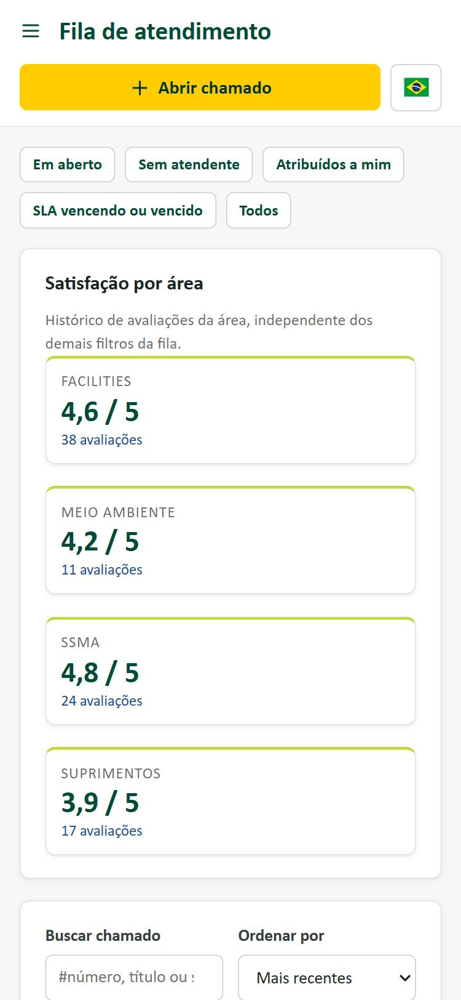

# Solicitação de Serviços e Chamados por Área

Data: 28/10/2026 · Salinas Gold Mineração LTDA · TI

Módulo de solicitação de serviços e acompanhamento de chamados internos (inspirado no fluxo ITIL/GLPI da Salinas), integrado ao padrão visual e de governança do **Salinas Access Gate**. Permite que áreas de suporte — como **SSMA**, **Facilities**, **Meio Ambiente**, **Suprimentos** e novas áreas cadastradas pelo Admin/TI — recebam, priorizem e solucionem demandas com controle de SLA, horário comercial, prorrogação justificada de prazos, notificações por e-mail com preferências individuais por usuário, pesquisa de satisfação, ajuda contextual (**Como usar**) e retenção LGPD.

---

## 1. Guia do Administrador (`chamados.configurar` e `configuracoes.gerir`)

O gerenciamento das áreas, equipes, categorias e formulários fica em **Serviços → Áreas e formulários** (`/servicos/config`), e os parâmetros globais de expediente, feriados, e-mail e retenção ficam em **Gestão → Configurações → Chamados** (`/configuracoes`), restritos ao perfil **Admin/TI**. A tela **Áreas e formulários** traz atalho direto (**Expediente e feriados**) no topo e na seção de categorias para **Configurações → Chamados**. Todas as alterações exigem token CSRF e são registradas na trilha de auditoria (`audit_log`).

### 1.1. Cadastrar e editar áreas de suporte
1. No bloco recolhível **Nova área de suporte**, informe:
   - **Nome da área** (ex.: `Manutenção Elétrica`, `Facilities`, `Suprimentos`);
   - **Identificador (slug)**: gerado automaticamente a partir do nome quando deixado em branco;
   - **Cor de identificação**: código hexadecimal validado no formato `#RRGGBB`, utilizado como marcador visual circular antes do nome da área na **Fila de atendimento**, em **Meus chamados** e na listagem administrativa. Ao abrir o cadastro de uma nova área, o sistema sugere automaticamente a primeira cor ainda não utilizada de uma paleta fixa de 8 cores com contraste WCAG AA sobre fundo branco (`ServicosConfigController::PALETA_CORES`: `#024B37`, `#B54708`, `#3E7B27`, `#1D4ED8`, `#7E22CE`, `#B91C1C`, `#0F766E`, `#BE185D`), mantendo o seletor de cor livre para troca pelo administrador. As quatro áreas da semente recebem cores distintas na migração `010_cores_areas.sql` (`SSMA` `#B54708` laranja, `Facilities` `#024B37` verde da marca, `Meio Ambiente` `#3E7B27` verde-folha e `Suprimentos` `#1D4ED8` azul), aplicadas somente quando a área ainda estiver com a cor padrão `#024B37` para não sobrescrever escolhas anteriores do administrador;
   - **Ordem de exibição** e **Descrição** resumida dos serviços atendidos.
   - **SLA padrão de resposta** e **SLA padrão de solução**: escolha um atalho de `15 min` a `30 d` (`15 min`, `30 min`, `1 h`, `2 h`, `4 h`, `8 h`, `1 d`, `2 d`, `3 d`, `5 d`, `7 d`, `15 d`, `30 d`) ou informe um prazo personalizado com número e unidade (`Minutos`, `Horas` ou `Dias`), aceitando de `1 minuto` até `365 dias` (`525600` minutos, gravados sempre em minutos na coluna `INT`). O campo personalizado prevalece sobre o atalho; ambos vazios significam sem prazo padrão na área.
   - **Regime de contagem do SLA**: **Horário comercial**, **Horas corridas (24x7)** ou **Seguir padrão global**. A última opção acompanha `horario_comercial_ativo`; o expediente e os feriados continuam globais. Com **Horário comercial** ativo, prazos expressos em dias consideram as horas úteis do expediente configurado (descontando noites, fins de semana e feriados).
2. Clique em **Adicionar área**.
3. Na listagem **Áreas de atendimento**, clique em **Configurar** na linha da área desejada para gerenciar sua equipe, suas categorias e seu formulário dinâmico, ou em **Editar** para alterar dados cadastrais e ativar/desativar a área.

### 1.2. Vincular equipe da área e devolução automática à triagem
1. Com a área selecionada, acesse o cartão **Equipe da área**.
2. Escolha um **Usuário ativo** do sistema e defina o **Papel na área**:
   - **Atendente**: visualiza a fila da área, assume chamados, registra acompanhamentos públicos, notas internas e soluções;
   - **Gestor**: além das atribuições de atendente, coordena a fila e distribui chamados entre os membros da equipe.
3. Clique em **Vincular membro**. Para alterar o papel de um membro já listado, basta selecioná-lo novamente com o novo papel.
4. A tabela da equipe exibe a coluna **Chamados abertos** com a quantidade e os números dos chamados em aberto (`status NOT IN ('solucionado', 'fechado')`) atribuídos a cada membro na área.
5. Ao clicar em **Remover**, todos os chamados abertos daquele membro na área são **devolvidos automaticamente à triagem** dentro da mesma transação (`atendente_id = NULL`, e `status = 'novo'` quando estavam em `'atribuido'`), registrando a transição em `chamado_acompanhamentos` e em `audit_log`, e exibindo na confirmação a lista dos chamados devolvidos.

### 1.3. Categorias em árvore, escala de urgência, prazos de SLA e horário comercial
Cada área possui sua própria árvore hierárquica de categorias e subcategorias (ex.: `Infraestrutura › Elétrica › Iluminação`):
1. No bloco **Nova categoria**, preencha:
   - **Nome da categoria**;
   - **Categoria pai**: selecione `— Raiz (sem categoria pai) —` para categoria de 1º nível ou escolha uma categoria existente da área para criar uma subcategoria;
   - **Urgência padrão** (`1 — Muito alta` a `5 — Muito baixa`, padrão `3 — Média`), unificada com a escala do motor de chamados (`App\Services\Chamados::URGENCIAS`: `1 = Muito alta`, `2 = Alta`, `3 = Média`, `4 = Baixa`, `5 = Muito baixa`);
   - **SLA de resposta** e **SLA de solução**: escolha um dos atalhos rápidos (`15 min`, `30 min`, `1 h`, `2 h`, `4 h`, `8 h`, `1 d`, `2 d`, `3 d`, `5 d`, `7 d`, `15 d`, `30 d`) ou informe um prazo personalizado com número e unidade (`Minutos`, `Horas` ou `Dias`, de `1 minuto` até `365 dias`), adequado também para demandas de compras, obras, projetos ou aguardo de fornecedor;
   - **Herdar da área**: deixe o atalho vazio e o campo personalizado vazio para usar o prazo padrão da área. A resposta e a solução herdam separadamente; um valor próprio da categoria prevalece, inclusive em subcategorias (não há herança da categoria pai). O valor herdado aparece ao lado do controle; a lista mostra os prazos efetivos (ex.: `7 d`, `30 d`, `2 h`, `30 min`) e sua origem (**SLA da categoria** ou **SLA da área**).
   - **Regime de contagem do SLA** (`usar_horario_comercial`): **Herdar da área**, **Horário comercial** ou **Horas corridas (24x7)**. Quando a área também segue o padrão, vale `horario_comercial_ativo`. Um regime explícito da categoria ou da área prevalece sobre esse padrão global.
2. Clique em **Adicionar categoria**.

A solução deve ter duração maior ou igual à resposta, considerando os valores herdados. A validação ocorre tanto ao salvar a categoria quanto ao alterar a área, verificando suas categorias, inclusive as inativas. Exemplo: área com resposta de `30 min` e solução de `2 h`; categoria sem valores próprios recebe esses dois prazos. Se a categoria definir resposta de `15 min`, mantém solução herdada de `2 h`.

A migração `009_sla_area.sql` adiciona padrões vazios nas áreas e permite `NULL` no regime da categoria, preservando seus valores anteriores. Categorias existentes com `0` ou `1` mantêm a escolha explícita; selecione **Herdar da área** para adotar o padrão. Alterar padrões não reescreve prazos nem calendários dos chamados já abertos. Na transferência, o SLA efetivo do destino começa no momento da operação; a primeira resposta já atendida conserva sua medição anterior.

### 1.4. Construtor de formulário dinâmico por área e categoria
O construtor permite criar perguntas extras específicas para uma área inteira ou apenas para uma categoria:
1. No cartão **Construtor de formulário**, informe:
   - **Rótulo do campo** (pergunta exibida ao solicitante);
   - **Tipo de resposta**:
     - `Texto curto` (até 500 caracteres);
     - `Texto longo` (múltiplas linhas, até 5.000 caracteres);
     - `Número` (inteiro ou decimal);
     - `Data` (`AAAA-MM-DD`);
     - `Lista (escolha única)` — exige informar as opções (uma por linha);
     - `Múltipla escolha` — caixas de seleção permitindo marcar uma ou mais opções da lista;
     - `Sim / Não`;
     - `Anexo` — validado no servidor via `App\Services\Upload` (PDF, JPG, PNG ou WEBP até 4 MB).
   - **Aplicar na categoria**: deixe em `— Todas as categorias da área —` para exibir o campo em qualquer chamado da área, ou escolha uma categoria específica;
   - **Opções**: uma opção por linha (obrigatório para `Lista` e `Múltipla escolha`);
   - **Texto de ajuda** e caixa **Preenchimento obrigatório**.
2. Na tabela de campos configurados, utilize os botões **↑** e **↓** para reordenar as perguntas, **Desativar/Ativar** para suspender ou reabilitar um campo sem perder o histórico, ou **Editar** para ajustar rótulo e opções.
3. As respostas de chamados já abertos são gravadas com cópia do rótulo do momento da abertura (`chamado_respostas`), preservando o histórico mesmo que o formulário seja alterado depois.

### 1.5. Calendário de expediente, notificações por e-mail e retenção (Etapa 2)
Em **Gestão → Configurações → Chamados** (`/configuracoes`) e no arquivo `.env`:
1. **Calendário de horário comercial**:
   - `horario_comercial_ativo`: padrão de regime quando categoria e área não têm escolha própria; `1` conta minutos úteis e `0` conta horas corridas;
   - `horario_dias`: dias úteis no padrão ISO (`1,2,3,4,5` = segunda a sexta-feira);
   - `horario_inicio` e `horario_fim`: janela diária de expediente (padrão `07:00` às `17:00`, em Horário de Mato Grosso – UTC-4);
   - `feriados`: datas `AAAA-MM-DD` (separadas por vírgula ou linha) que não contam no relógio de SLA.
2. **Notificações por e-mail (fila assíncrona)**:
   - Configure o envio de e-mail em **Configurações** ou no `.env` e ative `email_ativo = 1`;
   - As ações web apenas enfileiram os avisos na tabela `email_fila` (`App\Services\Notificacoes::chamado`), respeitando as preferências individuais de cada destinatário (`App\Services\PreferenciasNotificacao::quer`), sem travar a resposta ao usuário. O disparo ocorre em segundo plano pelo comando `php bin/console.php enviar-emails` (agendado no cron a cada 5 minutos), com até 5 tentativas em espera crescente e proteção contra vazamento de credenciais em `ultimo_erro`;
   - **Minimização de dados (LGPD)**: os e-mails contêm apenas metadados essenciais (número, título, área, categoria, status, prioridade) e o link direto para o chamado. Notas internas, descrições livres, beneficiários e respostas de formulário nunca são enviados por e-mail.
3. **Fechamento automático e retenção LGPD**:
   - `chamados_fechar_dias` (padrão: `7` dias): chamados em `solucionado` sem interação do solicitante após esse prazo são fechados pelo comando diário `php bin/console.php fechar-chamados`, marcando `fechado_automaticamente = 1`;
   - `retencao_chamados_meses` (padrão: `24` meses, mínimo `6` meses): no job diário `php bin/console.php aplicar-retencao`, chamados com status `fechado` e `fechado_em` anterior ao prazo têm seus anexos apagados (`chamado_anexos` e arquivos em disco), `descricao` e `beneficiario_nome` definidos como `NULL`, e textos de `chamado_respostas` e `chamado_acompanhamentos` substituídos por `[removido por retenção]`, preservando número, área, categoria, datas, prioridade e nota de satisfação para indicadores estatísticos;
   - Registros da `email_fila` já enviados há mais de 30 dias também são expurgados automaticamente pela rotina de retenção.

---

## 2. Abertura de Chamados e Ajuda Contextual (`chamados.abrir`)

Em **Serviços → Abrir chamado** (`/chamados/abrir`):
- **Seleção direta de área e categoria**: ao escolher a **Área de atendimento**, o seletor de **Categoria** é limpo automaticamente (`data-limpar-alvo="categoria_id"`) e o formulário é recarregado (`data-autosubmit`); ao escolher a categoria, os campos específicos e os prazos de SLA da categoria são carregados sem exigir clique extra. O botão **Carregar formulário** permanece disponível como alternativa sem JavaScript.
- **Beneficiário condicional**: o campo **Nome de quem receberá o atendimento** (`#campo-beneficiario`) só é exibido e marcado como obrigatório quando **O atendimento é para você?** está selecionado como **Não** (`0`), mantendo validação no servidor.
- **Explicação visível dos níveis de urgência**: o quadro **Como escolher a urgência** (`1 — Muito alta` a `5 — Muito baixa`) vem aberto por padrão para orientar o solicitante no preenchimento.
- **Aviso dinâmico de SLA**: o texto informativo no rodapé usa a mesma regra de herança da gravação e da transferência: categoria → área → sem prazo. Mostra o regime efetivo (comercial ou 24x7) e as durações de primeira resposta e solução, inclusive quando herdadas da área.
- **Ajuda contextual (`Como usar`)**: todas as telas do módulo (`/chamados/abrir`, `/chamados/meus`, `/chamados/fila`, `/chamados/{id}` e `/servicos/config`) contam com procedimentos passo a passo e tour guiado no botão **Como usar** da barra superior e na central **Tutoriais** (`/tutoriais`).

---

## 3. Guia para Atendentes e Gestores de Área (`chamados.atender`)

Usuários vinculados a pelo menos uma área de suporte (ou com perfil **Admin/TI**) acessam **Serviços → Fila de atendimento** (`/chamados/fila`):

### 3.1. Triagem, marcador de cor da área, filtros e indicadores da fila
- Filtre os chamados por **Área**, **Status**, **Categoria**, **Prioridade**, **Atendente responsável** e **Situação do prazo** (`No prazo`, `Vencendo` quando resta ≤ 20% do tempo, ou `Vencido`).
- **Marcador de cor da área**: na **Fila de atendimento** e em **Meus chamados**, cada chamado exibe um pequeno marcador circular SVG (`fill="#RRGGBB"`, validado por expressão regular com fallback seguro para `#024B37` e `aria-hidden="true"`, sem estilos inline para conformidade com a CSP) antes do nome da área, facilitando a distinção visual imediata entre áreas como **SSMA**, **Facilities**, **Meio Ambiente** e **Suprimentos**.
- A **Prioridade (1 a 6)** é calculada automaticamente pela matriz **Urgência (`1 = Muito alta` .. `5 = Muito baixa`) × Impacto (`1 = Muito alto` .. `4 = Baixo`)** definida no chamado.
- O painel da fila apresenta também a **média de satisfação** (1 a 5 estrelas) das áreas que já possuem avaliações registradas pelos solicitantes (permanecendo oculto quando nenhuma área foi avaliada e recolhível em telas pequenas).
- Use **Atribuir a mim** para assumir o chamado imediatamente ou selecione outro membro da área.

### 3.2. Atendimento, pausa de SLA, prorrogação de prazo e solução
1. Na tela de detalhe do chamado, consulte os dados do solicitante, o beneficiário (quando aberto em nome de terceiro), as respostas do formulário dinâmico, os anexos e a **linha do tempo** completa.
2. **Acompanhamentos**:
   - **Comentário público**: visível ao solicitante e aos atendentes (gera notificação por e-mail para a outra parte);
   - **Nota interna**: visível exclusivamente para atendentes da área e Admin/TI (nunca gera e-mail ao solicitante).
3. **Status e relógio de SLA**:
   - Ao receber o primeiro atendimento/atribuição, o sistema registra o horário de resposta (`respondido_em`);
   - Quando o chamado depende de retorno do solicitante ou de fornecedor externo, altere o status para **Pendente**: o relógio do SLA de solução **pausa automaticamente** enquanto o chamado permanecer em `pendente`, retomando ao voltar para `atribuido` ou `planejado`;
   - Ao concluir a execução, registre a **Solução** (status muda para `solucionado`, grava `solucionado_em` e notifica o solicitante).
4. **Prorrogar prazo de solução por chamado** (migração `012_prorrogacao_prazo.sql`):
   - Para a equipe da área (e Admin) em chamados não fechados (`status <> 'fechado'`), o bloco recolhível **Prorrogar prazo de solução** permite estender o prazo de solução do chamado sem alterar o SLA padrão da categoria;
   - Oferece atalhos rápidos (`+1 dia`, `+3 dias`, `+7 dias`, `+15 dias`) e campo personalizado com número e unidade (`Minutos`, `Horas`, `Dias`, de `1 minuto` a `365 dias`), exigindo obrigatoriamente o **Motivo da prorrogação** (`prorrogacao_motivo`, até 2.000 caracteres);
   - `Chamados::prorrogar` calcula o novo `prazo_solucao` respeitando o calendário gravado no chamado (horário comercial ou 24x7) e preservando integralmente a pausa acumulada de `pendente` (`segundos_pendente` e `pendente_desde`);
   - Acumula o tempo adicionado em `chamados.prazo_prorrogado_min` (exibido junto ao prazo de solução como `(+7 d prorrogado)`), registra um evento público na linha do tempo (`tipo = 'prorrogacao'`) com o tempo adicionado, o novo prazo e o motivo, e grava `Audit::log('chamados', $id, 'prorrogar', ...)` com o prazo anterior, o novo prazo e a justificativa.

### 3.3. Aprovação, fechamento e pesquisa de satisfação
- Após solucionado, o solicitante pode **Aprovar e fechar** (passando o chamado para `fechado`) ou **Reabrir** (retornando para `atribuido` caso a demanda não tenha sido sanada).
- Quando o chamado passa para **Fechado**, o solicitante pode registrar uma única **avaliação de satisfação de 1 a 5 estrelas** com comentário opcional, exibida para a equipe no detalhe do chamado e consolidada no indicador da fila.

---

## 4. Preferências de Notificação por E-mail (`/conta/notificacoes`)

Cada usuário autenticado pode escolher quais avisos de chamados deseja receber por e-mail em **Minha conta → Notificações por e-mail** (`/conta/notificacoes`, migração `011_preferencias_notificacao.sql`, serviço `App\Services\PreferenciasNotificacao` e controlador `App\Controllers\ContaNotificacoesController`):
1. **Padrão compatível (ausência de linha = ligado)**: na tabela `usuario_notificacoes (usuario_id, evento, ativo, updated_at)`, a ausência de registro para um evento significa **ativo (`true`)**, preservando o comportamento padrão para todas as contas existentes até que o próprio usuário desmarque algum evento.
2. **E-mail da conta e aviso de envio global**: a tela exibe o endereço de e-mail cadastrado/sincronizado via Active Directory do usuário. Quando o envio global de e-mails está desligado (`Email::estaAtivo() === false`), exibe um aviso informativo explicando que nenhuma mensagem será disparada enquanto o envio estiver desativado, mas permite salvar as preferências normalmente.
3. **Eventos configuráveis por papel**:
   - **Como solicitante (meus chamados)**:
     - `solicitante.criado`: Chamado recebido / aberto;
     - `solicitante.atribuido`: Atribuído a um atendente;
     - `solicitante.comentario`: Novo comentário público;
     - `solicitante.pendente`: Mudou para pendente (aguardando você);
     - `solicitante.solucionado`: Solucionado (aprovar ou reabrir);
     - `solicitante.fechado`: Fechado ou fechado automaticamente.
   - **Como atendente / equipe da área** (exibido somente para membros de áreas de suporte ou Admin):
     - `atendente.criado`: Novo chamado na minha área;
     - `atendente.atribuido`: Chamado atribuído a mim;
     - `atendente.comentario`: Comentário do solicitante;
     - `atendente.transferido`: Chamado transferido para minha área;
     - `atendente.reaberto`: Reaberto pelo solicitante.
4. **Ações rápidas e auditoria**: botões **Salvar preferências**, **Desligar todos** e **Restaurar padrão**, protegidos por CSRF e auditados em `audit_log` (`entidade = 'usuario_notificacoes'`). `App\Services\Notificacoes` consulta `PreferenciasNotificacao::quer($destinatarioId, $evento)` antes de enfileirar cada mensagem, mantendo as travas de segurança (nunca notificar o autor da própria ação, nunca enviar nota interna e validar apenas membros ativos da área).

## Telas do portal de chamados

Capturas com dados fictícios (28/10/2026), no padrão visual do Access Gate:

| Tela | Imagem |
|---|---|
| Fila de atendimento (atalhos, satisfação por área, busca, filtros e prazos) |  |
| Abrir chamado (perfil Colaborador, formulário da categoria, urgência, SLA) |  |
| Meus chamados |  |
| Detalhe do chamado — atendente (atribuir, status, transferir, linha do tempo) |  |
| Detalhe do chamado — solicitante (aprovar ou reabrir) |  |
| Áreas e formulários (SLA padrão da área, equipe, categorias, formulário) |  |
| Fila no tema escuro |  |
| Celular: abrir chamado e fila |   |
