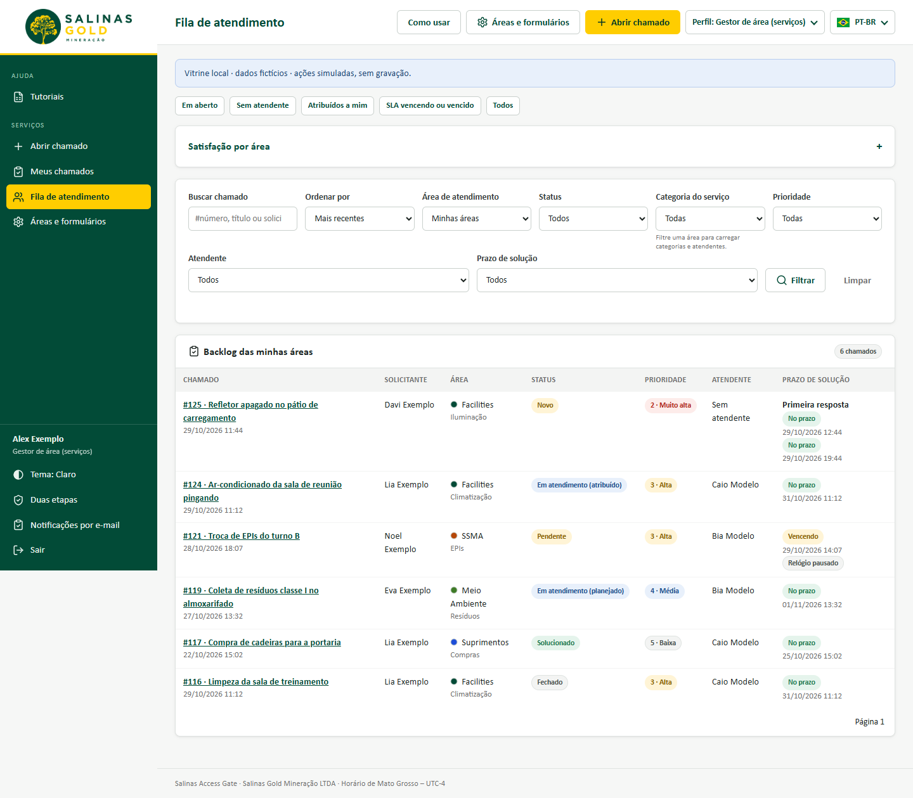
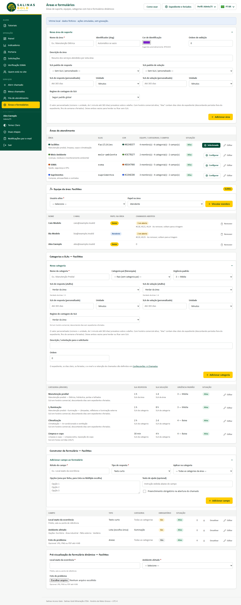

# Guia rápido — Gestor de área

Para o responsável por uma área de serviço, como SSMA, Facilities, Meio Ambiente ou Suprimentos. O gestor acompanha o backlog da área e ajusta seus serviços e formulários.

## Acompanhar o backlog

1. No topo da tela, mude o perfil ativo para **Gestor de área**.
2. Abra **Serviços → Fila de atendimento**. A fila mostra só as suas áreas.
3. Use os atalhos para filtrar os chamados:
   - **Sem atendente**: o que ainda não foi distribuído;
   - **SLA vencendo ou vencido**: o que exige prioridade.
4. Distribua os chamados com **Atribuir**. Se um chamado não for da sua área, use **Transferir**.

## Prazos (SLA)

- Cada área tem um prazo padrão de **resposta** e de **solução**. Ele pode ir de 15 minutos a 365 dias e ser contado em horário comercial ou 24x7.
- Cada categoria pode ter prazos próprios ou **herdar da área**.
- Quando um serviço precisar de mais tempo, use **Prorrogar prazo de solução** no próprio chamado. O motivo é obrigatório e fica registrado.

## Ajustar serviços e formulários

Em **Serviços → Áreas e formulários**, na sua área:

- **Equipe:** inclua ou remova atendentes. Os chamados abertos de quem sai voltam para a triagem.
- **Categorias:** crie os serviços oferecidos, com urgência e prazos.
- **Formulário:** acrescente as perguntas que a área precisa, marque as obrigatórias e defina a ordem.

As mudanças só valem para os **novos** chamados. Criar ou desativar uma área e nomear gestores é com o Admin/TI.

Vídeos: [atender um chamado](videos/v04-atender-chamado.webm) · [configurar uma área](videos/v05-configurar-area.webm)
