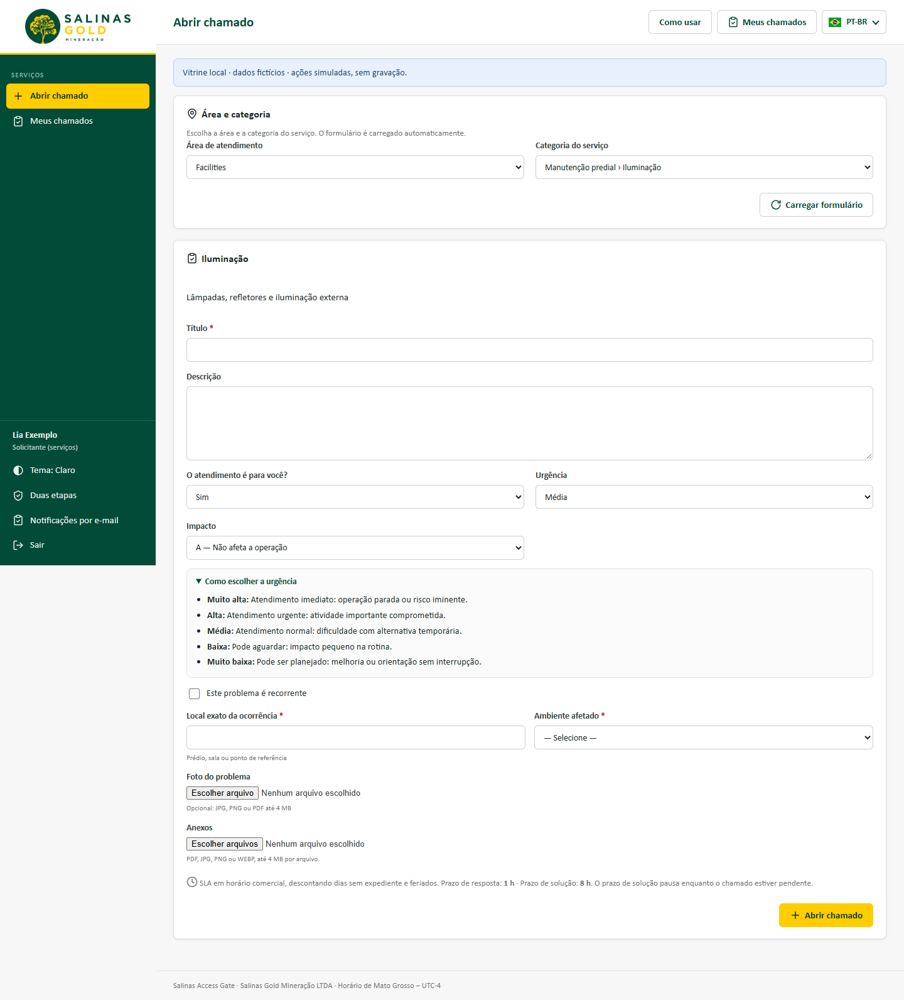

# Guia rápido — Solicitante (portal de serviços)

Para quem precisa pedir algo a uma área de suporte: SSMA, Facilities, Meio Ambiente, Suprimentos e outras.

## Abrir um chamado

1. Entre no Access Gate com o seu usuário de rede.
2. No menu, abra **Serviços → Abrir chamado**.
3. Escolha a **área** e depois a **categoria** do serviço. O formulário da área aparece logo abaixo.
4. Preencha:
   - um **título** curto, como "Lâmpada queimada na sala 12";
   - a **descrição** do que precisa.
5. Indique se o pedido é **para você** ou para outra pessoa.
6. Escolha a **urgência** e o **impacto**.
7. Responda às perguntas da área. Se quiser, anexe fotos ou PDF de até 4 MB cada.
8. Clique em **Abrir chamado** e anote o **número** que aparecer.

## Acompanhar

- **Serviços → Meus chamados** mostra o status, o prazo e a última atualização de cada chamado.
- Para responder à equipe ou mandar um arquivo, use **Adicionar acompanhamento**.
- Se a equipe pedir alguma informação, o chamado fica como **Pendente** e o prazo pausa até você responder.

## Concluir

- Quando o chamado estiver **Solucionado**, você tem duas opções:
  - **Aprovar e fechar**;
  - **Reabrir**, explicando o que faltou.
- Se você não responder em 7 dias, o chamado fecha sozinho.
- Depois de fechado, dê de **1 a 5 estrelas** ao atendimento.

## Dicas

- Para avisos por e-mail, escolha as situações em **Notificações por e-mail**, no rodapé do menu.
- Um pedido por chamado ajuda a área a atender mais rápido.

Vídeos: [abrir um chamado](videos/v02-abrir-chamado.webm) · [acompanhar e aprovar](videos/v03-acompanhar-e-aprovar.webm)
