# Salinas Access Gate — Manual do usuário

Versão 1.0 · outubro de 2026 · Salinas Gold Mineração LTDA

O **Salinas Access Gate** controla quem entra e sai das unidades da Salinas Gold (portaria, visitantes, terceiros, veículos e
segurança do trabalho) e reúne o **portal de serviços**, onde as áreas de suporte — SSMA, Facilities, Meio Ambiente, Suprimentos e
outras — recebem e acompanham as demandas dos colaboradores.

Este manual descreve o sistema do ponto de vista de quem usa: o que aparece na tela, como fazer cada tarefa e o que fazer quando algo
não sai como esperado. As imagens usam **dados fictícios**.

> Guias rápidos de uma página: [Solicitante](GUIA-RAPIDO-SOLICITANTE.md) · [Portaria](GUIA-RAPIDO-PORTARIA.md) ·
> [Gestor de área](GUIA-RAPIDO-GESTOR-DE-AREA.md) · [Perguntas frequentes](FAQ.md) · [Glossário](GLOSSARIO.md)

---

## Sumário

1. [Primeiros passos](#1-primeiros-passos)
2. [Perfis: quem vê o quê](#2-perfis-quem-vê-o-quê)
3. [Painel](#3-painel)
4. [Portaria](#4-portaria)
5. [Solicitações de acesso](#5-solicitações-de-acesso)
6. [Verificação SSMA](#6-verificação-ssma)
7. [Quem está no site](#7-quem-está-no-site)
8. [Cadastros: pessoas, veículos e locais](#8-cadastros-pessoas-veículos-e-locais)
9. [Indicadores, relatórios e auditoria](#9-indicadores-relatórios-e-auditoria)
10. [Serviços: chamados por área](#10-serviços-chamados-por-área)
11. [Administração](#11-administração)
12. [Sua conta](#12-sua-conta)
13. [Privacidade e segurança](#13-privacidade-e-segurança)
14. [Ajuda dentro do sistema](#14-ajuda-dentro-do-sistema)

---

## 1. Primeiros passos

### 1.1 Entrar

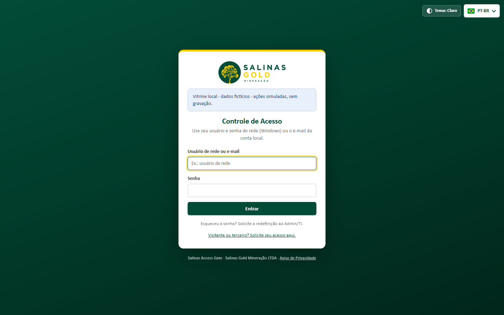

1. Abra o endereço do Access Gate informado pela TI.
2. Digite seu **usuário de rede** (o mesmo do Windows) ou o **e-mail** da conta local e a senha.
3. Clique em **Entrar**.

Se a sua conta usa **verificação em duas etapas**, o sistema pede o código de 6 dígitos do aplicativo autenticador do celular:

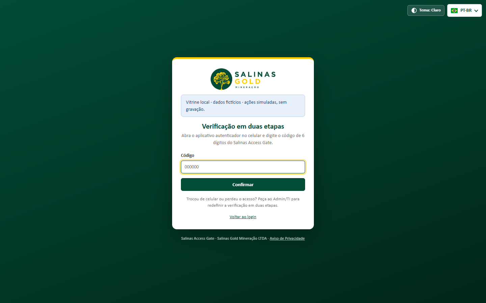

- Errou a senha várias vezes? O acesso fica bloqueado por alguns minutos. Aguarde e tente de novo.
- Esqueceu a senha da conta local? Peça a redefinição ao Admin/TI. A senha da rede é a mesma do Windows.

### 1.2 A tela principal

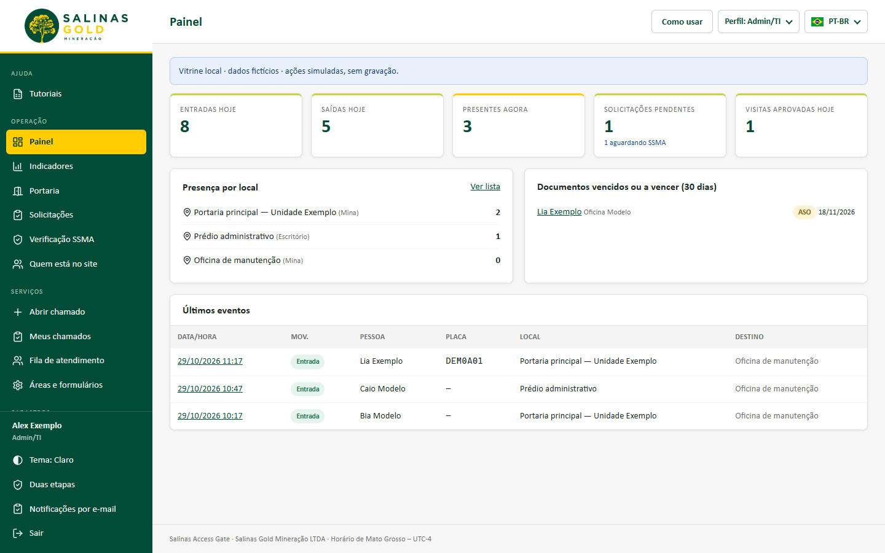

- **Menu lateral (verde):** os itens mudam conforme o seu perfil. Clicar no logotipo da Salinas Gold volta ao início.
- **Topo:** título da tela, botões da página, **seletor de perfil** e **seletor de idioma**.
- **Rodapé do menu:** seu nome, tema (claro/escuro), verificação em duas etapas, notificações por e-mail e **Sair**.

### 1.3 Perfil ativo

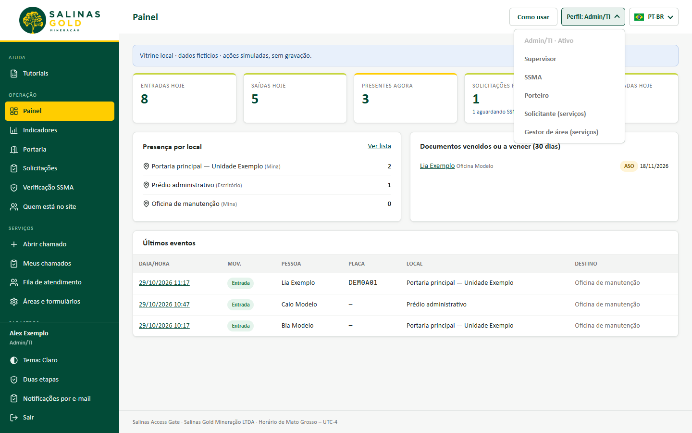

Uma pessoa pode ter mais de um perfil (por exemplo, Porteiro e Solicitante). O **perfil ativo**, escolhido no topo
("Perfil: …"), define o menu e o que você pode fazer naquele momento. O Admin/TI pode trabalhar em qualquer perfil e voltar ao
Admin/TI para configurar. Toda troca de perfil fica registrada.

### 1.4 Idioma e tema

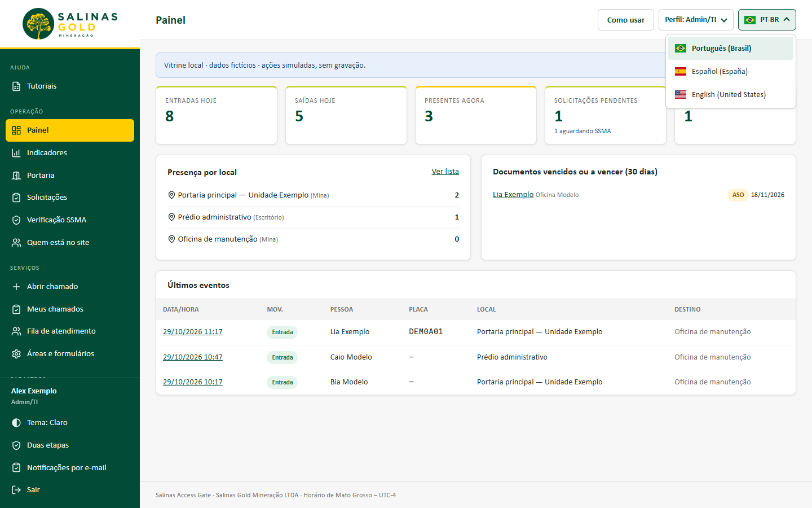

- **Idioma:** clique na bandeira do topo e escolha Português (Brasil), Español (España) ou English (United States).
  Os dados cadastrados (nomes, placas, empresas) não são traduzidos.
- **Tema:** no rodapé do menu, alterne entre Automático (segue o Windows/celular), Escuro e Claro.

[Vídeo: entrar e escolher o perfil](videos/v01-entrar-e-escolher-perfil.webm) ·
[Vídeo: trocar idioma e tema](videos/v07-trocar-idioma-e-tema.webm)

---

## 2. Perfis: quem vê o quê

| Função | Admin/TI | Supervisor | SSMA | Porteiro | Gestor de área | Solicitante |
|---|:-:|:-:|:-:|:-:|:-:|:-:|
| Operar a portaria (entradas e saídas) | ✔ | | | ✔ | | |
| Ver e cadastrar pessoas | ✔ | ✔ | ✔ | ✔ | | |
| Ver CPF completo | ✔ | ✔ | | | | |
| Documentos (ASO, NRs, integração, CNH) | ✔ | ✔ | ✔ | | | |
| Veículos (cadastrar) | ✔ | ✔ | | ✔ | | |
| Locais | ✔ | ✔ | | | | |
| Solicitações de acesso | ✔ | ✔ | ✔ | ✔ | | |
| Verificação SSMA | ✔ | | ✔ | | | |
| Indicadores | ✔ | ✔ | ✔ | | | |
| Relatórios e auditoria | ✔ | ✔ | | | | |
| Abrir e acompanhar chamados | ✔ | ✔ | ✔ | ✔ | ✔ | ✔ |
| Atender chamados da área | ✔ | membro | membro | membro | suas áreas | |
| Configurar áreas, categorias e formulários | ✔ (todas) | | | | suas áreas | |
| Usuários e configurações gerais | ✔ | | | | | |

**Quem autoriza visitas:** Admin/TI, usuários marcados como **Segurança Patrimonial** e o **responsável da área**.
O porteiro nunca autoriza.

---

## 3. Painel

Mostra a operação do dia: entradas, saídas, presentes agora, solicitações pendentes, visitas aprovadas, presença por local,
documentos vencidos ou a vencer e os últimos eventos.

**O que fazer se** um número não bater com o que você vê na portaria: confira o local e os registros de entrada e saída antes de
concluir que há divergência; comunique a supervisão.

---

## 4. Portaria

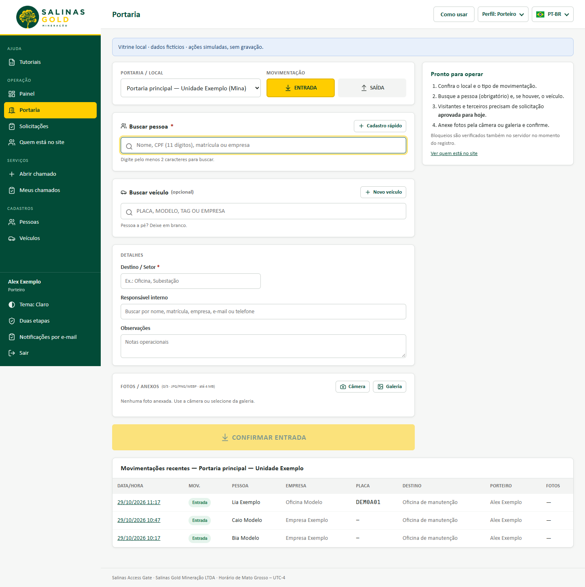

### Registrar uma entrada ou saída

1. Confira o **local** no topo e escolha **ENTRADA** ou **SAÍDA**.
2. Em **Buscar pessoa**, digite ao menos 2 letras do nome, CPF ou matrícula e selecione o cadastro correto.
   Pessoa nova? Use o **cadastro rápido**.
3. Se houver veículo, pesquise a **placa**. Para acesso a pé, deixe em branco.
4. Confira o quadro de análise:

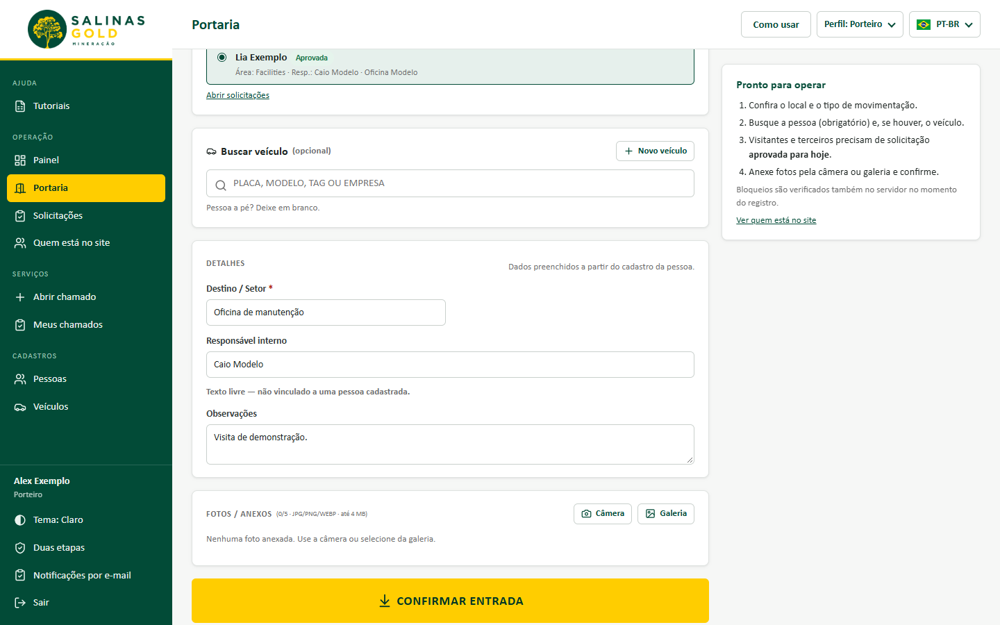

   - visitante ou terceiro precisa de **solicitação aprovada para hoje**;
   - atividade de risco precisa de **verificação SSMA "Apto"** válida;
   - documentos vencidos de terceiros **bloqueiam**; documentos perto de vencer só **avisam**.
5. Informe destino e responsável interno, tire as **fotos** necessárias e clique em **CONFIRMAR ENTRADA** (ou SAÍDA).

[Vídeo: registrar uma entrada na portaria](videos/v06-registrar-entrada-portaria.webm)

**O que fazer se:**

- **Aparecer "Entrada bloqueada":** não libere. Leia o motivo (solicitação, SSMA, documento, cadastro inativo) e acione o responsável.
- **A solicitação não aparece:** ela precisa estar aprovada para hoje. Se o CPF da solicitação for diferente do cadastro, o sistema
  pede confirmação e registra na auditoria — confira o documento antes.
- **Registrou errado:** os registros não podem ser apagados ou editados. Não "compense" com outro movimento; comunique a supervisão/TI.

---

## 5. Solicitações de acesso

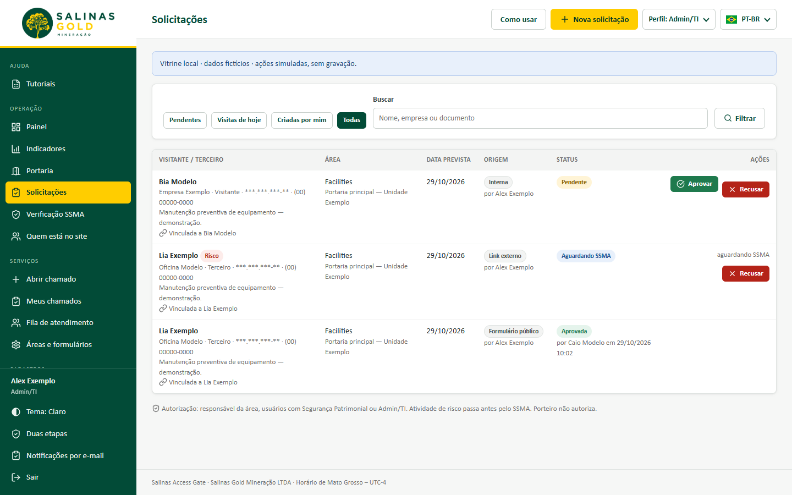

1. Use **Nova solicitação** e informe nome, tipo (visitante ou terceiro), área responsável e data prevista.
2. Complete empresa, contatos, local e motivo. Marque **Atividade de risco** quando houver (vai para o SSMA).
3. Clique em **Criar solicitação** — ou em **Gerar link externo** para o próprio visitante preencher (link válido por 72 h):

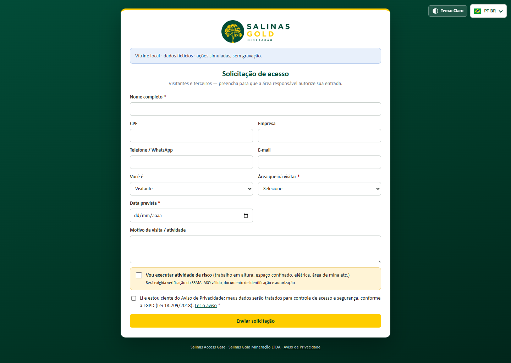

4. Acompanhe nas abas **Pendentes**, **Visitas de hoje**, **Criadas por mim** e **Todas**.

Criar a solicitação **não** autoriza a entrada: quem autoriza é o responsável da área, a Segurança Patrimonial ou o Admin/TI.

---

## 6. Verificação SSMA

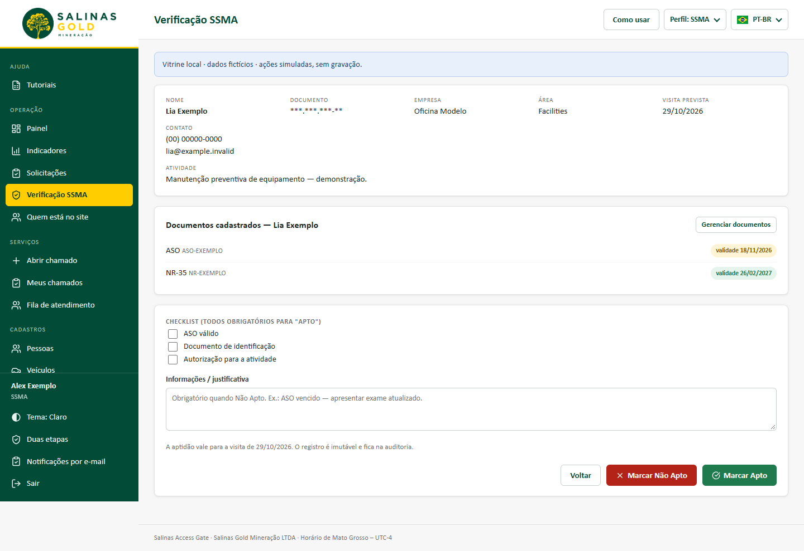

1. Na fila, clique em **Verificar** na solicitação aguardando análise.
2. Confira a atividade, a identificação, o **ASO** e os itens do checklist.
3. Marque **Apto** (cumprindo os itens) ou **Não apto** (com justificativa) e confirme.

A aptidão vale para a visita indicada. O registro não pode ser alterado depois.

---

## 7. Quem está no site

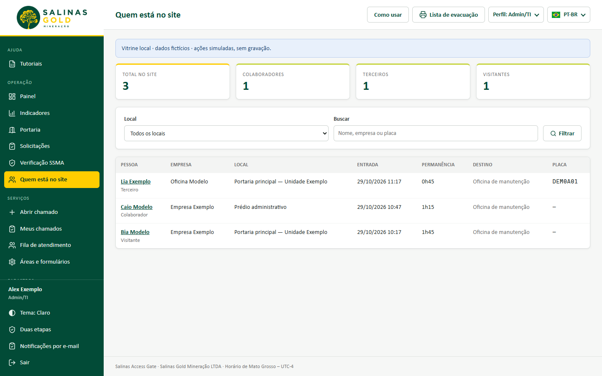

Lista quem tem a **entrada** como último movimento em cada local, com destaque para permanências longas.
Use **Lista de evacuação** para imprimir em emergências. Se alguém saiu sem registrar, a pessoa continua na lista: confira e comunique.

---

## 8. Cadastros: pessoas, veículos e locais

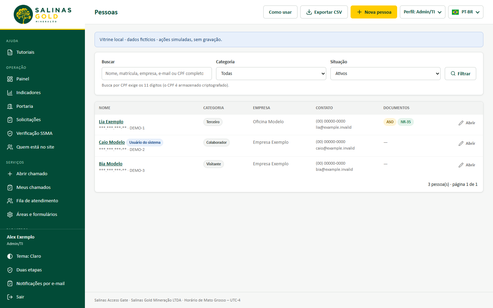

**Pessoas:** pesquise antes de cadastrar (para CPF, digite os 11 dígitos). Em **Nova pessoa**, preencha nome completo e categoria
(colaborador, visitante ou terceiro) e os contatos. No cadastro, os perfis autorizados mantêm **documentos e validades**
(ASO, NR-22, NR-35, NR-33, integração, CNH). O CPF aparece mascarado; apenas Admin/TI e Supervisor podem revelá-lo, e cada consulta
fica registrada.

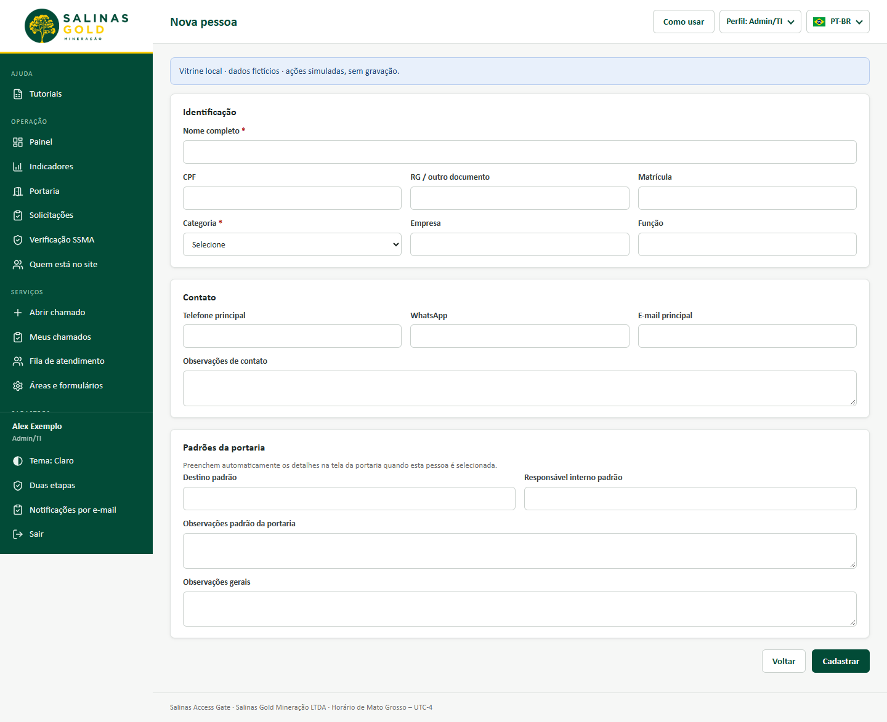

**Veículos:** pesquise a placa, informe tipo, modelo, cor, empresa e o **comissionamento** para a mina.

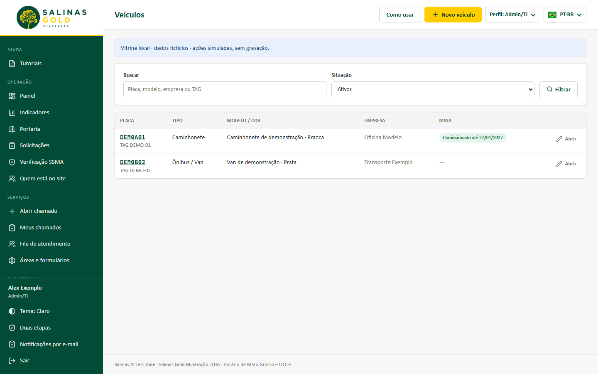

**Locais:** os pontos físicos (Mina ou Escritório) usados na portaria.

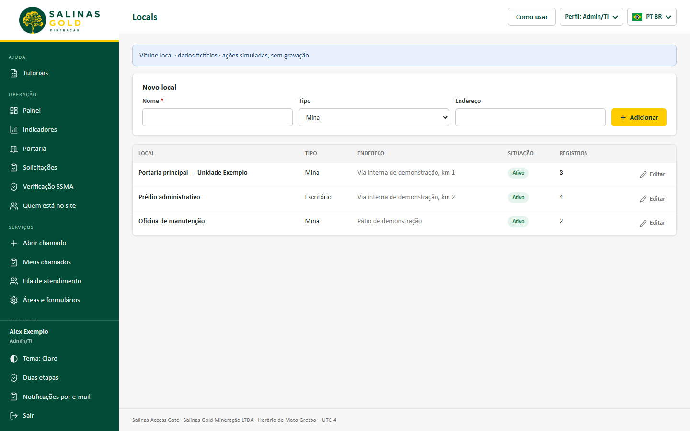

---

## 9. Indicadores, relatórios e auditoria

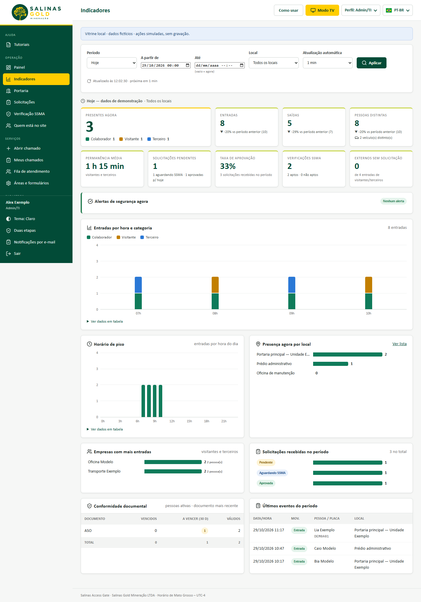

- **Indicadores:** escolha período e local; veja presentes agora, entradas/saídas, permanência média, picos, empresas e solicitações.
  Cada gráfico tem "Ver dados em tabela". O **Modo TV** amplia para monitores da portaria.
- **Relatórios:** filtre por datas, local, sentido e categoria, abra os detalhes e **exporte CSV**. Guarde o arquivo conforme a
  orientação interna (contém dados pessoais).

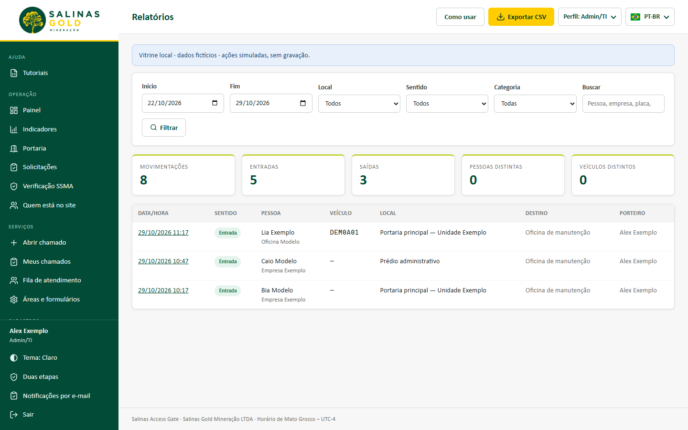

- **Auditoria:** a trilha de quem fez o quê e quando. Use apenas para apurações autorizadas.

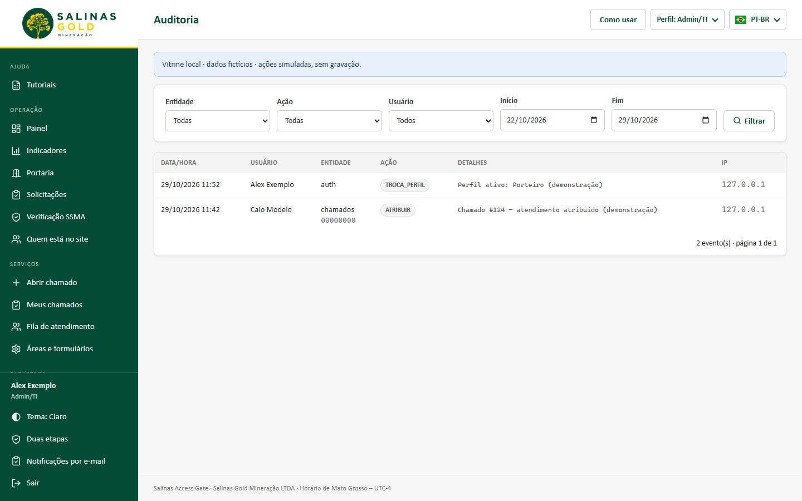

---

## 10. Serviços: chamados por área

O portal de serviços substitui pedidos por e-mail ou telefone para as áreas de suporte. Cada área tem seus **serviços (categorias)**,
**prazos (SLA)** e um **formulário** com as perguntas que ela precisa.

### 10.1 Abrir um chamado

1. Em **Serviços → Abrir chamado**, escolha a **área** e a **categoria** — o formulário aparece sozinho.
2. Escreva um **título** curto e a **descrição** do que precisa.
3. Diga se o atendimento é **para você** ou para outra pessoa, e se o problema é **recorrente**.
4. Escolha a **urgência** (as explicações aparecem na tela) e o **impacto** (A a D).
5. Responda às perguntas da área, anexe fotos ou PDF (até 4 MB cada) e clique em **Abrir chamado**.

O chamado recebe um **número** e entra na fila da área com os prazos calculados (em horário comercial ou 24 h, conforme o serviço).

[Vídeo: abrir um chamado](videos/v02-abrir-chamado.webm)

### 10.2 Acompanhar, aprovar e avaliar

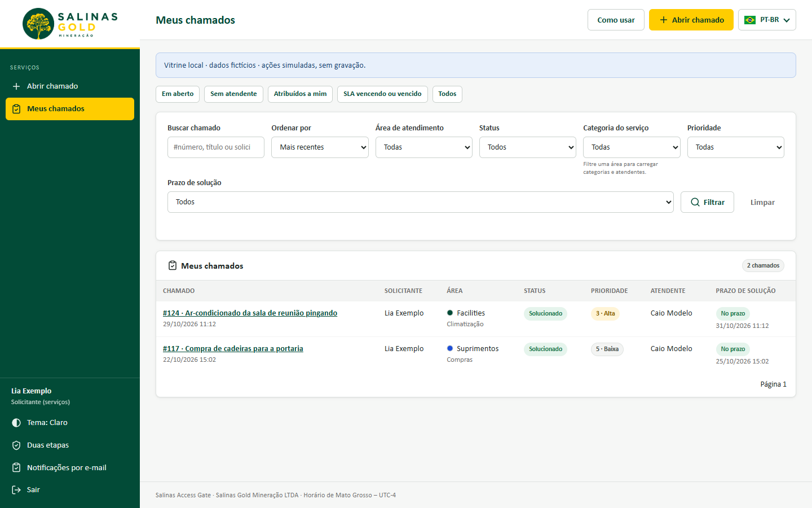

- Em **Meus chamados**, veja o status, a prioridade e o prazo de cada pedido; clique para abrir a linha do tempo.
- Use **Adicionar acompanhamento** para responder à equipe ou enviar arquivos.
- Quando o chamado estiver **Solucionado**, escolha **Aprovar e fechar** ou **Reabrir** (com o motivo). Sem resposta em
  7 dias, ele fecha sozinho.
- Depois de fechado, **avalie de 1 a 5 estrelas** — a área usa a nota para melhorar.

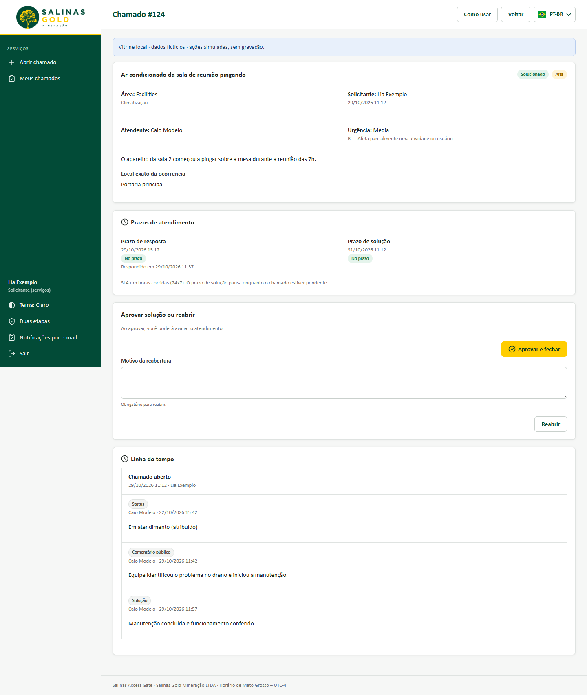

[Vídeo: acompanhar e aprovar](videos/v03-acompanhar-e-aprovar.webm)

### 10.3 Atender (equipe da área)

- A **Fila de atendimento** mostra os chamados das suas áreas. Use os atalhos **Em aberto**, **Sem atendente**, **Atribuídos a mim**
  e **SLA vencendo ou vencido**, a busca por número/título/solicitante e a ordenação por prioridade ou prazo.
- No chamado: **Atribuir a mim** (ou a um colega), **Comentário público** (o solicitante vê), **Nota interna** (só a equipe),
  mudar o status, **Transferir** para outra área/categoria e **Solucionar** com a descrição da solução.
- **Pendente** pausa o prazo de solução enquanto se aguarda retorno do solicitante ou de terceiros.

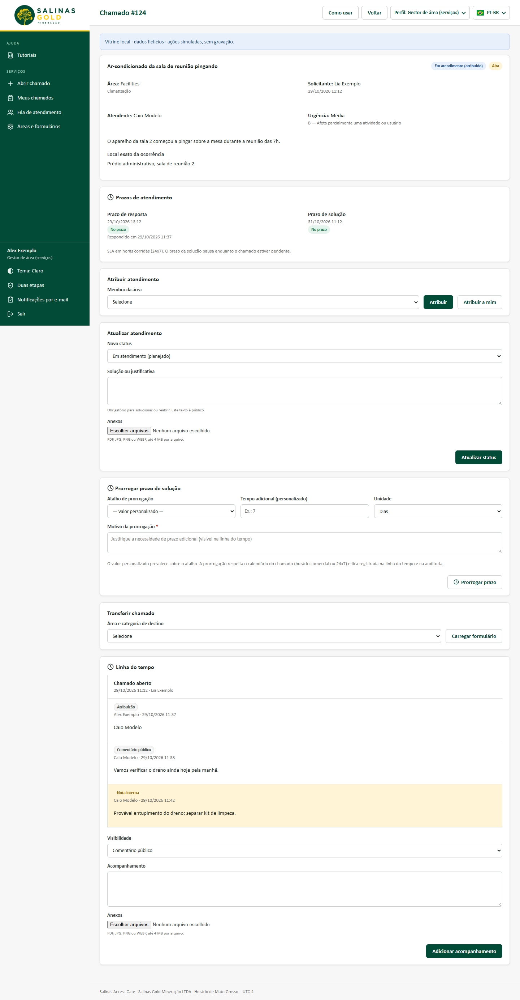

**Prorrogar o prazo:** quando o serviço precisa de mais tempo (compra, terceiro, parada programada), use **Prorrogar prazo de solução**
(+1, +3, +7, +15 dias ou valor livre) com o **motivo** — fica na linha do tempo e na auditoria.

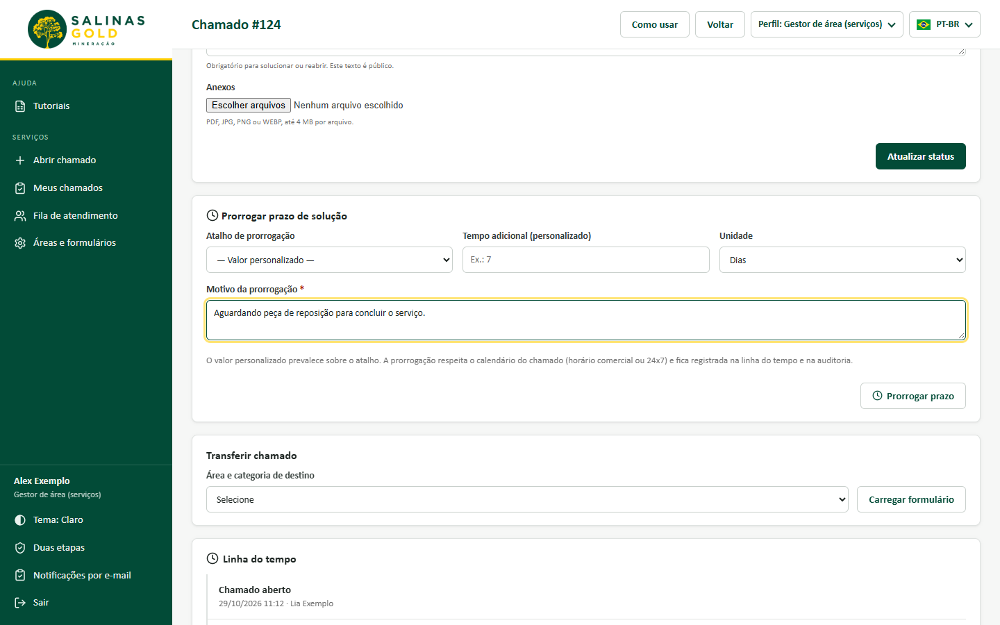

[Vídeo: atender um chamado](videos/v04-atender-chamado.webm)

### 10.4 Configurar uma área (Admin/TI e Gestor de área)

1. **Área:** nome, descrição, cor e o **SLA padrão** (resposta e solução, de 15 minutos a 365 dias; horário comercial ou 24x7).
   Criar ou desativar áreas é exclusivo do Admin/TI.
2. **Equipe:** vincule os atendentes (e, pelo Admin/TI, os gestores). Ao remover alguém, os chamados abertos dessa pessoa voltam
   para a triagem.
3. **Categorias:** os serviços da área, em árvore, com urgência padrão e prazos próprios — ou **"Herdar da área"**.
4. **Formulário:** adicione perguntas (texto, número, data, lista, múltipla escolha, sim/não, anexo), marque as obrigatórias e ordene.

As mudanças valem para os **novos** chamados; os já abertos guardam as respostas e os prazos da época.

[Vídeo: configurar uma área](videos/v05-configurar-area.webm)

---

## 11. Administração

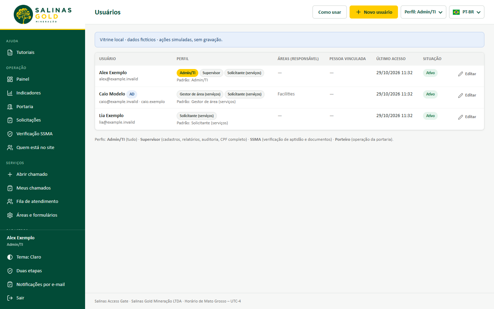

- **Usuários:** crie contas locais ou vincule usuários do Active Directory; marque os **perfis permitidos** e o **perfil padrão**;
  marque **Segurança Patrimonial** para quem autoriza visitas.

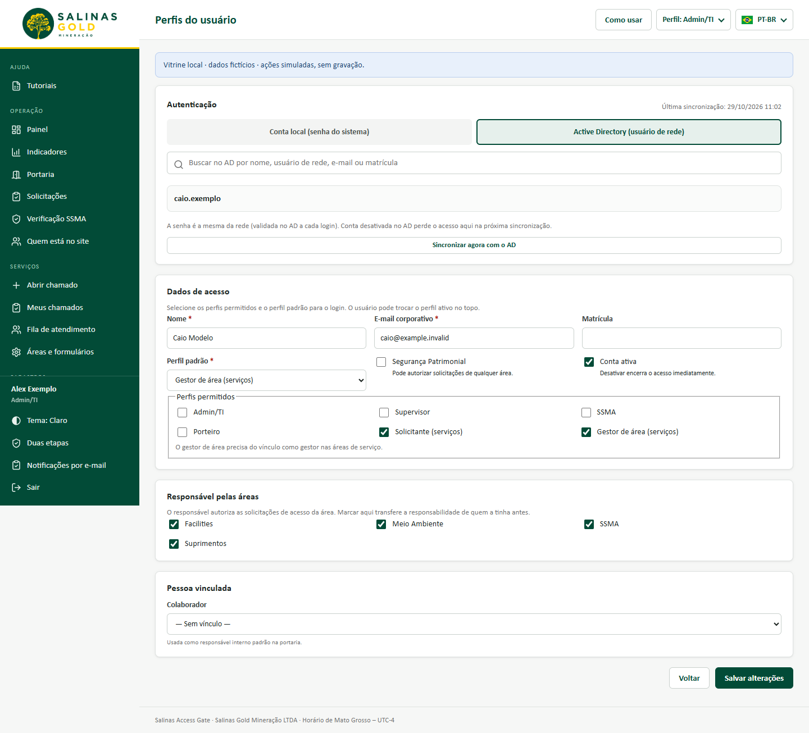

- **Configurações:** dados da organização, regras da portaria, formulário público, **Encarregado (DPO)**, prazos de retenção (LGPD),
  verificação em duas etapas obrigatória para Admin/TI, horário comercial e feriados dos chamados, e envio de e-mails.

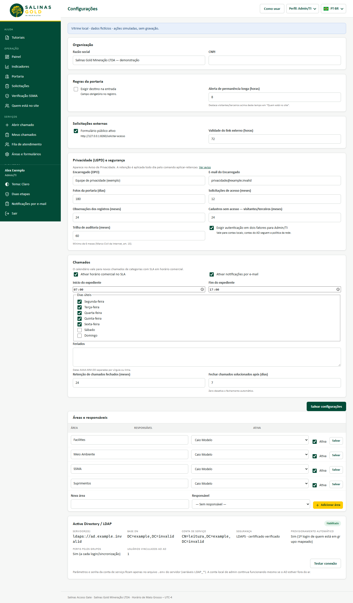

Mudanças nas configurações afetam toda a operação: avalie o impacto e valide depois de salvar.

---

## 12. Sua conta

### Notificações por e-mail

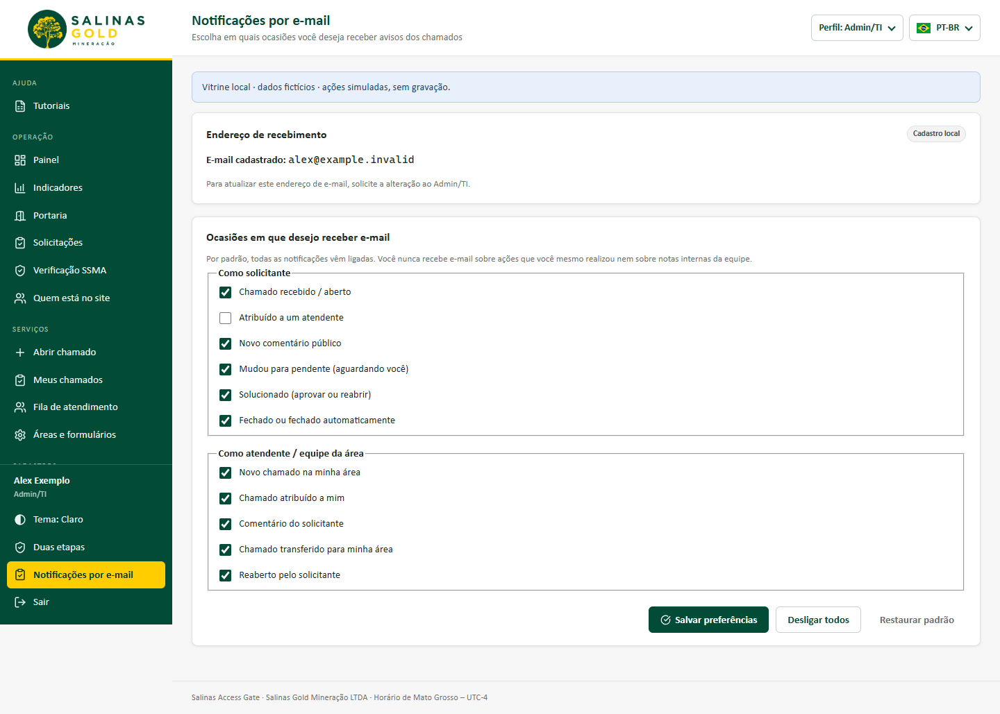

No rodapé do menu, **Notificações por e-mail** permite escolher em quais situações receber aviso — como solicitante (aberto, atribuído,
novo comentário, aguardando você, solucionado, fechado) e como atendente (novo chamado na área, atribuído a mim, comentário do
solicitante, transferido, reaberto). Você nunca recebe e-mail sobre o que você mesmo fez nem sobre notas internas.

### Verificação em duas etapas

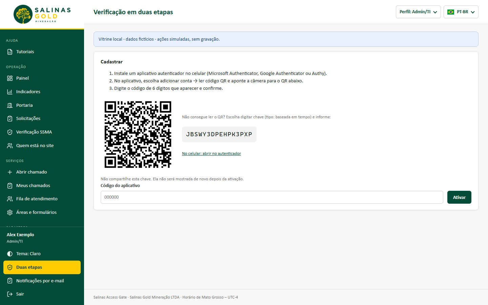

1. Instale um aplicativo autenticador (Microsoft Authenticator, Google Authenticator ou Authy).
2. Em **Duas etapas**, leia o **código QR** com o aplicativo (ou digite a chave).
3. Informe o código de 6 dígitos e clique em **Ativar**.

Para Admin/TI ela é obrigatória. Trocou de celular? Peça a redefinição ao Admin/TI.

[Vídeo: notificações e duas etapas](videos/v08-notificacoes-e-duas-etapas.webm)

---

## 13. Privacidade e segurança

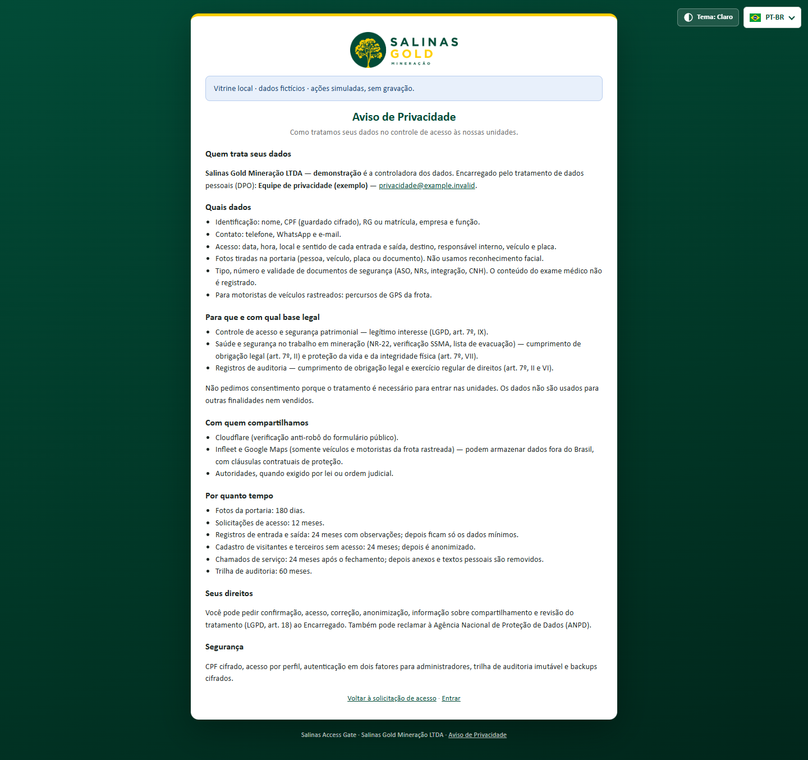

- O **Aviso de Privacidade** (link no rodapé das telas públicas) explica quais dados o sistema trata, para quê, por quanto tempo e
  como exercer seus direitos (LGPD).
- O CPF é guardado **cifrado** e aparece mascarado; fotos e anexos só abrem para quem tem permissão.
- Dados antigos são **apagados ou anonimizados automaticamente** após os prazos definidos pela empresa.
- Use sempre a **sua** conta. Não compartilhe senha nem o código de duas etapas.
- Toda ação relevante fica na **auditoria** (quem, o quê, quando e de onde).

---

## 14. Ajuda dentro do sistema

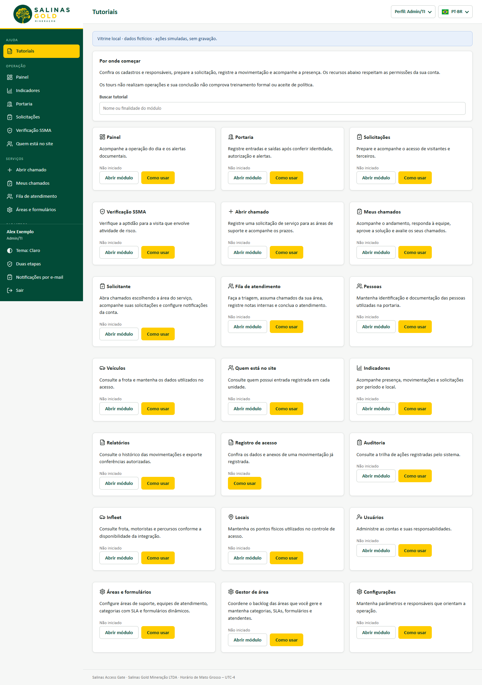

- **Tutoriais** (menu Ajuda) reúne o passo a passo de cada tela, por perfil.
- O botão **Como usar**, no topo das telas, abre o tour guiado daquela página. O tour só mostra a tela; ele não preenche nem confirma nada.

---

*Dúvidas ou problemas: TI da Salinas Gold — ti@salinasgold.com.br.*
